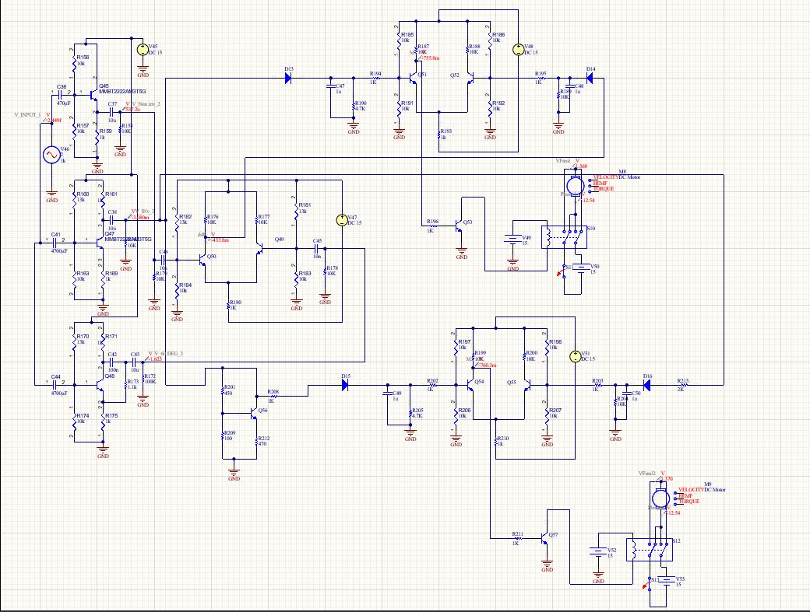

# Discrete Signal-Logic Motor Control

An analog control system that decides, from an AC input signal, when and how to run two DC motors, built **without any integrated circuits**. Phase-shifted copies of the input are compared with transistor differential pairs, a voltage-controlled current source is tested against a 2× threshold, and the result drives a relay that reverses a motor. Designed and simulated in Altium Designer.

## What it does

- Generates an inverted copy, a non-inverted copy and a 60° phase-shifted copy of a 1 kHz input signal.
- Subtracts signals with a BJT differential pair and compares their magnitudes (Motor 1 logic: is |Vamp1| smaller or larger than |Vdiff|).
- Converts the input into a proportional current with a voltage-controlled current source (VCIS) and triggers Motor 2 when I_VCIS ≥ 2 × I_amp2.
- Drives the motor through a transistor and a DPDT relay wired as an H-bridge, so the rotation direction reverses.
- A normally-closed push button in the motor's power path stops the motor.

## Full schematic



## Files

```
altium/Sheet1_Motor.SchDoc   schematic
docs/                        schematic image
```

## Tech

Altium Designer, discrete BJTs (MMBT2222A), 1N4148 and 1N4007 diodes, DPDT relay.
