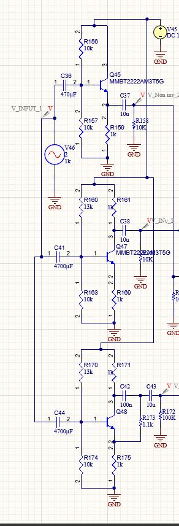
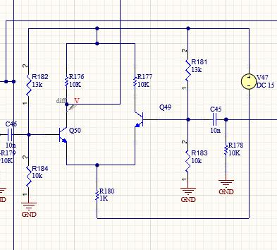
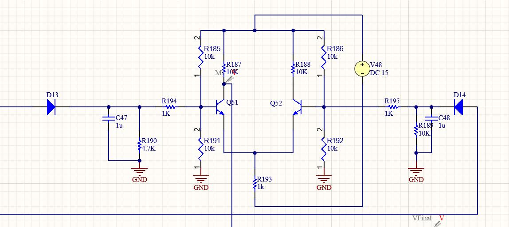
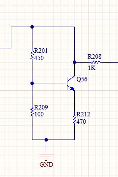
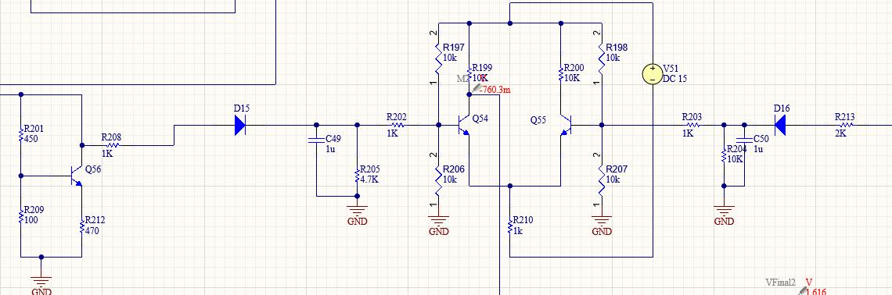
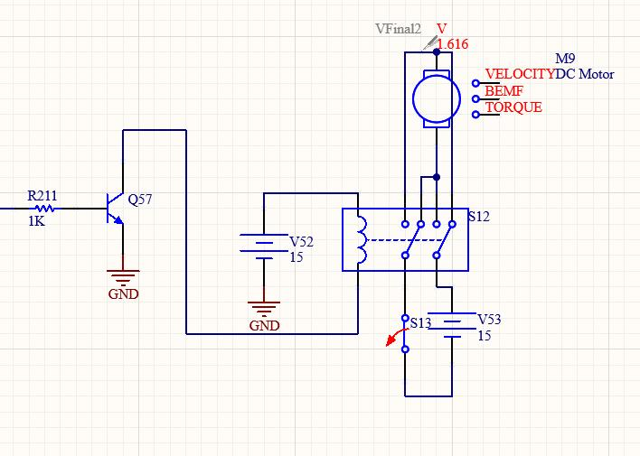

# Discrete Signal-Logic Motor Control

An analog control system that decides, from an AC input signal, when and how to run two DC motors, built **without any integrated circuits**. Phase-shifted copies of the input are compared with transistor differential pairs, a voltage-controlled current source is tested against a 2× threshold, and the result drives a relay that reverses a motor. Designed and simulated in Altium Designer.

## What it does

- Generates an inverted copy, a non-inverted copy and a 60° phase-shifted copy of a 1 kHz input signal.
- Subtracts signals with a BJT differential pair and compares their magnitudes (Motor 1 logic: is |Vamp1| smaller or larger than |Vdiff|).
- Converts the input into a proportional current with a voltage-controlled current source (VCIS) and triggers Motor 2 when I_VCIS ≥ 2 × I_amp2.
- Drives the motor through a transistor and a DPDT relay wired as an H-bridge, so the rotation direction reverses.
- A normally-closed push button in the motor's power path stops the motor.

## Full schematic


## Block breakdown

All stages use MMBT2222A NPN transistors on a single 15 V DC supply.

### 1. Amplification and phase displacement

Three reference signals are generated from the input:

- **Amplifier 1 (Q47):** common-emitter stage, gain of about 1 and 180° inversion.
- **Amplifier 2 (Q45):** emitter follower, a high-impedance buffer with 0° shift. It feeds the VCIS and differential stages.
- **60° phase shifter:** an RC lead network (R173 and C42) after a buffer stage.



### 2. Differential comparison

A BJT differential pair (Q50 and Q49) with a 1 kΩ common tail resistor (R180) subtracts the non-inverted signal and the 60° shifted signal. The collector of Q50 gives Vdiff.



### 3. Magnitude sensing (Motor 1 logic)

Raw AC cannot be compared directly without relay chatter, so peak detectors (D13 with C47, and D14 with C48) turn the AC peaks into stable DC levels. A second differential pair (Q51 and Q52) compares them:

- |Vamp1| < |Vdiff|: Q51 cuts off and its collector goes HIGH.
- |Vamp1| > |Vdiff|: Q51 saturates and its collector goes LOW.



### 4. Voltage-controlled current source (Motor 2)

An NPN transistor (Q56) in a current-source topology turns the output of Amplifier 2 into a current. The emitter resistor R212 sets the transconductance.



### 5. Current-threshold comparison (Motor 2 logic)

Motor 2 should trigger when I_VCIS ≥ 2 × I_amp2. With discrete parts this is done by sense-resistor scaling: I_VCIS passes through a 1 kΩ resistor and the reference through a 2 kΩ resistor (R145), so the two voltages match only when I_VCIS is double the reference. A transistor comparator (Q54 and Q55) senses them, and when Vsense1 ≥ Vsense2 the motor is triggered to rotate left.



### 6. Power driver

- **Transistor driver:** Q57 is a low-side switch. Its base is driven through a 1 kΩ resistor (R211) and it saturates at about 0.7 V, connecting the relay coil to ground.
- **DPDT relay H-bridge:** with a separate 15 V supply, the relay in its rest state gives the motor "right" polarity. When Q57 energizes the coil, the contacts flip and the current through the motor reverses ("left").
- **Stop button:** a normally-closed push button in the motor's power path interrupts the high-current path and stops the motor.



## Design calculations

**Phase shifter.** For a lead network, φ = arctan(1 / (ωRC)). For 60° at 1 kHz, RC = 1 / (2π × 1000 × tan 60°) ≈ 9.19 × 10⁻⁵ s. The build uses R ≈ 1.1 kΩ and C = 100 nF, which gives about 55°, close to the 60° target. An exact 60° would need R ≈ 919 Ω with the same capacitor.

**VCIS.** I_VCIS = (Vamp2 − VBE) / R_emitter.

**Motor 1 logic.** |Vamp1| compared with |Vdiff| sets the motor direction.

**Motor 2 logic.** I_VCIS ≥ 2 × I_amp2, tested as V1 = I_VCIS × R against V2 = I_amp2 × 2R.

**Switching.** The relay driver turns on when V_BE ≥ 0.7 V and the transistor saturates.

## Lessons learned

- **AC into the drivers does not work.** Feeding the raw AC from the differential amplifier straight into the driver transistors gave errors. A half-wave peak detector (diode and capacitor) converting it to DC fixed it.
- **Clipping from low headroom.** With a 5 V supply the bias points sat around 4.5 V, leaving only 0.5 V of headroom, so larger signals were clipped at the rail. Raising the supply to 15 V solved it.
- **Logic levels sag.** Voltage drops were fixed with active pull-up networks.
- **The Altium motor model does not spin.** In simulation the motor model does not visibly rotate, so I added a voltage probe on the motor output to see which polarity, and therefore which direction, was being driven.

## Conclusion

The project shows that this kind of analog control logic, comparing signals, thresholding a current and reversing a motor, can be built from basic discrete components with no integrated circuits.

## Files

```
altium/PCB_Project_Motor.PrjPcb   Altium project
altium/Sheet1_Motor.SchDoc        schematic
docs/                             full schematic and block images
```

Open `Sheet1_Motor.SchDoc` directly in Altium Designer if the project file reports missing sheets.

## Tech

Altium Designer, discrete BJTs (MMBT2222A), 1N4148 and 1N4007 diodes, DPDT relay.
